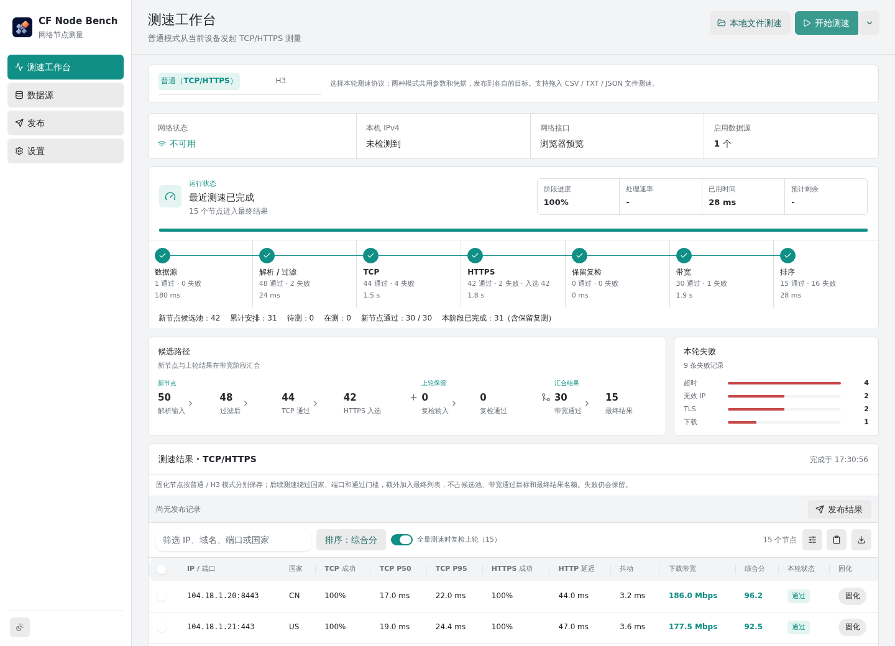

<div align="center">
  
  <h1>CF Node Bench</h1>
  <p>在你的设备上筛选低延迟、高带宽的 Cloudflare 节点。</p>
  <p>
    <a href="https://github.com/linvva/cf-node-bench/releases">下载应用</a> ·
    <a href="docs/usage.md">使用指南</a> ·
    <a href="docs/development.md">开发指南</a> ·
    <a href="https://github.com/linvva/cf-node-bench/issues">反馈问题</a>
  </p>
</div>

## 项目简介

CF Node Bench 是面向 Windows、macOS 和 Linux 的 Cloudflare 节点测速工具，在本机完成连通性检测、HTTP 请求和真实下载测速，并根据测量结果筛选、评分和排序。

- **两种测速模式**：普通 TCP/HTTPS 与基于 QUIC 的 H3 测速，支持 IPv4 节点和 H3 域名入口。
- **多种节点来源**：HTTP 数据源、本地 CSV / TXT / JSON 文件，以及文件拖入。
- **灵活保留结果**：支持节点固化、上轮结果复检、阶段重测，以及取消时保留完整通过的节点。
- **统一结果分发**：支持复制、导出，以及发布到 Cloudflare DNS、GitHub 仓库、Gist 和 Telegram。
- **应用更新**：从 GitHub Release 检查新版本，下载并校验签名后重启安装。

## 截图



*界面示例使用演示数据。*

## 如何使用

1. 从 [Releases](https://github.com/linvva/cf-node-bench/releases) 选择适合系统和 CPU 架构的文件：Windows、Linux 直接运行可执行文件，macOS 解压后打开应用。Linux 首次运行需添加执行权限，具体步骤见[使用指南](docs/usage.md)。
2. 启用 HTTP 数据源，或在工作台选择、拖入本地节点文件。
3. 选择普通或 H3 模式，按需调整设置，点击“开始测速”。
4. 查看结果，复制或导出所需节点；需要持续保留的节点可“固化”，需要分发时在“发布”页配置目标。

安装要求、节点格式、测速规则和发布配置见[使用指南](docs/usage.md)。Telegram 专属中继见[部署说明](deploy/telegram-relay/README.md)。

## 项目技术栈

| 用途 | 技术 |
| --- | --- |
| 桌面应用与后端 | Go、Wails 3 |
| QUIC 与 HTTP/3 | quic-go |
| 前端应用 | React、TypeScript、Vite |
| 界面与样式 | HeroUI、Tailwind CSS |
| 图表与图标 | Apache ECharts、Lucide |
| 工程与测试 | pnpm、Vitest、Playwright、Go testing |

## 开发说明

准备 Go、Node.js、pnpm、Wails 3 CLI 及平台依赖后，在仓库根目录运行：

```bash
pnpm install --frozen-lockfile
wails3 task dev
```

仅预览前端可运行 `pnpm dev`。环境配置、测试和构建命令见[开发指南](docs/development.md)，依赖要求以仓库中的配置与锁文件为准。

---

项目思路参考 [xinyitang3/cfnb](https://github.com/xinyitang3/cfnb)。项目遵循 [GNU GPL 许可](LICENSE)，第三方资源许可可在应用“设置”中离线查看，源码中的[相关声明](frontend/public/THIRD_PARTY_NOTICES.md)也可查阅。
