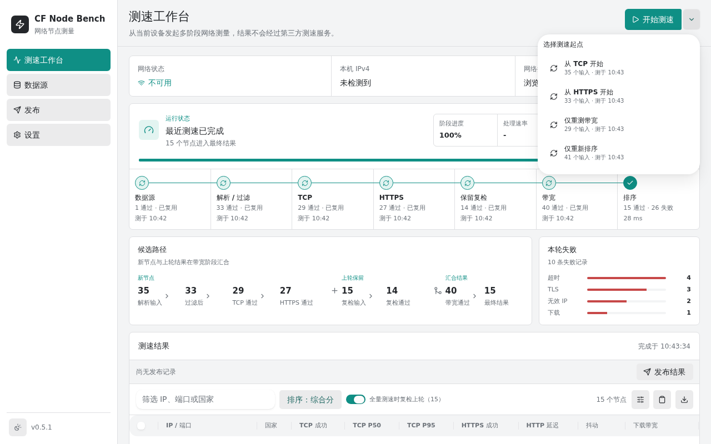

# CF Node Bench

CF Node Bench 是一个跨平台 Cloudflare 候选 IP 测速工具。它在应用实际运行的设备上完成数据源获取、TCP 与 HTTPS 可用性探测、真实下载测速和综合评分，帮助筛选低延迟、高带宽、高可用节点。

应用提供“普通（TCP/HTTPS）”和“H3”两种互斥测速模式。普通模式执行 TCP/HTTPS 测速；H3 模式通过 QUIC/UDP 验证 HTTP/3 入口并进行 H3 下载测速，适用于筛选 XHTTP/H3 的入口候选。两种模式共用测速参数、发布凭据和历史，分别配置发布目标。



## 下载与运行

从 [GitHub Releases](https://github.com/linvva/cf-node-bench/releases) 下载与系统匹配的压缩包，解压后直接运行：

| 系统                        | 下载文件              | 运行方式                                                                       |
| --------------------------- | --------------------- | ------------------------------------------------------------------------------ |
| Windows 10/11 x64           | `windows-amd64.zip`   | 运行 `CF-Node-Bench.exe`，系统需有 WebView2 Runtime                            |
| macOS Intel / Apple Silicon | `macos-universal.zip` | 打开 `CF-Node-Bench.app`；当前构建未签名，首次运行可在 Finder 中右键选择“打开” |
| Linux x64                   | `linux-amd64.tar.gz`  | 运行 `./CF-Node-Bench`，系统需有 GTK3 和 WebKitGTK 4.1 运行库                  |

每个 Release 同时提供 `SHA256SUMS.txt`。压缩包无需安装本应用；系统 WebView、GTK 等桌面运行库不包含在压缩包内。

## 使用方法

1. 使用网络数据源时，打开“数据源”并启用至少一个 HTTP 数据源。内置示例可以修改或删除，也可以添加自己的地址。数据源支持 `IPv4:port#国家代码`、`IPv4:port`、裸 IPv4、空白分隔文本，以及包含 `ip`/`host`、`port`、`country`/`cc` 的 JSON。本地文件可直接从工作台选择，无需配置数据源。
2. 打开“设置”，按当前设备和网络调整并发、超时、探测次数、候选池、下载测速地址、最大下载量和评分权重。端口或允许国家为空表示不限；排除国家始终优先于允许国家。
3. 回到“测速工作台”并点击“开始测速”。界面会持续显示数据源、解析/过滤、TCP、HTTPS、保留复检、带宽和排序阶段的输入、通过、失败、耗时及失败原因；测速过程中可以随时取消。
4. 完成后可在结果表格中排序、筛选、选择、复制或导出。点击任意节点可查看 TCP、HTTPS、带宽，以及“归一化分 × 本轮权重 = 得分贡献”的评分明细。“全量测速时优先复检上轮结果”开关只影响下一次全量测速。
5. 如需自动分发结果，打开“发布”配置 Cloudflare、GitHub 仓库、GitHub Gist 或 Telegram。各目标相互独立，可以同时启用。保存后，每次成功完成测速都会在后台发布到该模式已配置且启用的渠道；未配置目标的渠道会跳过，不会借用另一模式的目标；取消测速不会发布，发布失败也不会改变测速结果。结果表格会显示各目标状态并允许手动重试。

点击工作台“本地文件测速”选择一个或多个 CSV/TXT/JSON 文件，或将文件拖入桌面应用窗口，释放后按当前普通/H3 模式开始测速。只测试这批文件中的候选，不混入 HTTP 数据源或上轮保留节点；沿用当前过滤、测速和发布设置，结果会标记为“本地文件”。文件需为 UTF-8（支持 BOM），单文件最多 10 MiB，单批最多 50 MiB；CSV 按表头读取 `IP地址`/`ip`/`host`/`address`、`端口号`/`port`、`IP位置`/`country`/`cc`，忽略出站 IP 和旧成绩；未提供端口列时默认 443。格式错误或任一文件没有有效节点时整批不启动。应用不保存文件路径，不增加数据源配置；阶段重测使用已保存的候选快照，再测文件最新内容时重新选择即可。测速或准备文件期间不能再次导入。

HTTPS 探测通过候选 `IP:port` 建立连接，但 TLS SNI 和 HTTP Host 均使用 `speed.cloudflare.com` 并正常验证证书。TCP 和 HTTPS 成功率是硬门槛，低可用节点不会仅凭高带宽进入最终排名。常规 HTTPS 阶段以“HTTP 候选数”为通过目标，失败时会继续从其余 TCP 通过节点补入，直到达到目标或候选耗尽。

TCP、HTTPS、QUIC、HTTP/3 每次采样后都会判断是否仍可能达到最低成功率：即使剩余采样全部成功也无法达标时，立即淘汰。例如探测 3 次且要求 100%，首次失败就停止；要求至少 2/3 时，累计两次失败才停止。通过的节点仍测满配置次数，保证延迟、抖动和成功率可用于评分；进度单独显示实际采样与提前跳过次数，跳过不计为网络失败。HTTPS、HTTP/3 和下载阶段按原候选顺序滚动补位，失败后立即补入后续候选，不再等待整批结束，新节点成功数不超过目标，实际 IP 并发不超过上限。普通 HTTPS 收到非 2xx 响应后立即关闭响应体。

上轮结果复测默认开启。常规测速中，最近一次同协议且验证目标一致的已完成运行的最终节点会优先进入快速复测并从本轮新节点池移除；若数据源仍包含同一 `IP:port`，复测节点会采用本轮国家和来源信息。它们复用上轮 TCP 指标，按当前端口、国家和 TCP 门槛过滤后执行一次 HTTPS 复检，再额外执行带宽测试。保留节点不占“带宽目标通过数”，因此会增加实际下载量；它们使用本轮 HTTPS 和带宽指标与新节点统一排名，一旦复检或下载失败便不会进入下一轮保留集合。取消的运行不会替代最近一次已完成结果。

完整阶段结束后，应用会保存当前结果的阶段检查点。完成首轮测速后，可点击“开始测速”右侧菜单选择：

- 从 TCP 开始：复用候选快照，按当前端口和国家重新过滤，再执行 TCP 及后续阶段。
- 从 HTTPS 开始：复用全部 TCP 结果，按当前门槛和候选数重新筛选，再执行 HTTPS 及后续阶段。
- 仅重测带宽：复用 HTTPS 通过池，重新执行全部带宽测试并排序。
- 仅重新排序：不发起网络请求，使用现有带宽结果、当前硬门槛和权重重新评分。

检查点超过 30 分钟、网络接口或本机 IPv4 变化、启用数据源变化，或被复用阶段的设置变化时，应用会先显示警告；确认后仍可继续。但如果被复用的阶段包含提前淘汰记录，降低该阶段的成功率门槛或改变采样次数后，必须从该阶段重新探测，不能通过确认旧检查点跳过。阶段重测可能混合不同时刻测得的指标，网络环境变化明显时应重新执行全量测速。取消任务时只保留已完整结束的阶段，当前阶段的部分采样会丢弃，因此可从该阶段重新开始。第一版只保留工作台当前结果对应的检查点，不提供历史检查点选择。

常规测速评分先执行 TCP 成功率、HTTPS 成功率和有效带宽硬门槛，未通过的节点不会因高带宽进入排名。通过节点沿用现有 min-max 归一化，再按五项权重求和；默认共享权重为带宽 40%、HTTP 请求 25%、连接 15%、可用性 15%、抖动 5%；普通模式分别使用 HTTPS、TCP 指标，H3 模式分别使用 HTTP/3、QUIC 指标。每项可设为 0–100，但总和必须等于 100；应用不开放公式、归一化方法或硬门槛编辑器。

带宽阶段同样连接候选 `IP:port`，但 TLS SNI、HTTP Host、路径和查询参数来自设置中的下载测速 URL。地址必须使用 HTTPS、能通过待测 Cloudflare CDN 节点访问并直接返回足够大的内容；本地“最大下载量”仍是实际读取上限。应用内置 Cloudflare 官方、Parallels 和 OpenBSD 三个候选，也允许输入自建地址。第三方地址可能限速、迁移或失效，稳定使用时应优先选择官方接口或自己的 Cloudflare 地址。候选选择参考 [Cloudflare 官方测速实现](https://github.com/cloudflare/speedtest) 与 [CloudflareSpeedTest 下载测速地址讨论](https://github.com/XIU2/CloudflareSpeedTest/discussions/490)。

## H3 测速模式

在工作台选择 **普通（TCP/HTTPS） / H3** 测速模式。普通模式完全沿用 TCP → HTTPS → 下载流程，不额外探测 H3。选择会保存并用于后续测速，运行中不能切换模式；本轮所有参数使用启动时的固定快照。

无需填写 Worker 域名即可开始：默认通过候选入口访问公共验证目标 `h3.speed.cloudflare.com`。设置页“H3 高级设置”允许填写自己的 Worker 域名，例如 `worker.example.com`，不含协议、端口或路径。不需要 UUID、密码或订阅地址。公共目标通过只证明候选能访问该公共域名；需要验证自己的部署域名时，应填写自己的域名。公共服务的可用性可能变化。

H3 模式依次执行数据源获取、过滤与 IPv4 DNS 解析、QUIC 握手、HTTP/3 验证、H3 下载和排名，不以 TCP 连通性作为门槛。连接固定为候选 `IP:端口`，握手和入口验证以验证域名作为 TLS SNI 与 HTTP Host，并正常验证证书；HTTP/3 请求访问 `/cdn-cgi/trace`。不会回退 HTTP/2 或 HTTP/1.1，也不会通过系统代理。

H3 数据源额外支持裸域名、`domain:port#CC` 和 JSON `host`，裸域名默认端口 443。每轮使用系统 DNS 解析域名的全部 IPv4 并固定本轮快照；同一实际 `IP:端口` 共享检测结果。域名只有全部 IPv4 通过握手、HTTP/3 和下载门槛才会保留，聚合取最高延迟和抖动、最低成功率和带宽。复制及文本发布保留原域名，详情显示逐 IP 指标和解析时间；后续 DNS 变化和 IPv6 不属于本轮已验证范围。普通模式仍只检测 IPv4 候选。

并发、探测次数、最低成功率、候选数、下载量、结果数、过滤条件和评分权重共用一份设置。默认连接、HTTP 各探测 3 次，最低成功率各为 2/3；并发分别为 64、16，下载并发为 3；HTTP 候选池为 150、下载目标为 30、最终结果为 15，失败时继续补入。H3 独有设置只有验证域名、QUIC 握手超时（默认 3 秒）、HTTP/3 请求超时（默认 6 秒）和 H3 下载 URL。

H3 下载通过同一候选入口强制发起 HTTP/3 请求，SNI 和 Host 来自下载 URL，拒绝重定向及不足 64 KiB 的结果。默认使用 `https://h3.speed.cloudflare.com/__down?bytes=99999999`，来自 [Cloudflare 官方 H3 测速站](https://h3.speed.cloudflare.com/)。更换的下载地址也必须支持 HTTP/3。默认每个实际 IP 最多下载 20 MiB，测量时间上限 12 秒。达到时间上限时，已收到至少 64 KiB 则按实际字节数和耗时计算带宽；无足够数据、用户取消或异常断流仍计为失败；多 IP 域名逐个下载，上轮保留节点也会完整复检，工作台显示累计下载量。

H3 支持从 QUIC、HTTP/3、下载和排序阶段重测。全量或 QUIC 重测会重新解析域名，后续阶段沿用带时间戳的 DNS 快照。全应用只保留一个当前检查点；切换测速模式后仅能复用候选，必须从 TCP 或 QUIC 重新检测。改变验证域名后必须从 QUIC 重新检测，不能通过“使用旧检查点”绕过。取消任务只保存已经完整结束的阶段。

“H3 入口已验证 · IPv4”仅针对本轮验证域名，不表示完整 XHTTP `stream-one`、ECH、客户端指纹或 ProxyIP 出站已经验证。下载成绩来自本应用的 QUIC 实现，不保证与客户端实际代理吞吐相同；导入结果后仍应在客户端验证完整链路。

普通和 H3 模式共用各渠道的凭据。在发布页切换“普通（TCP/HTTPS） / H3”编辑对应目标：Cloudflare 共用 Token、Zone ID 和 TTL，分别设置记录名与 A/TXT 类型；GitHub 共用 Token、仓库和分支，分别设置文件路径；Gist 共用 Token，分别设置 Gist ID 和文件名（支持同一 Gist 的不同文件，也支持另一 Gist）。Telegram 共用聊天和中继配置，消息标明实际协议。发布页的模式切换只选择要编辑的目标，不改变工作台的测速模式。

H3 目标默认留空。未配置某模式的目标时，该模式会跳过该渠道，绝不回退到另一模式；例如只配置普通 Gist 时，H3 测速不会修改该 Gist。可以只配置 H3 目标而不配置普通目标。两种模式已配置的目标必须不同；Cloudflare 同名记录即使 A/TXT 类型不同也不允许，避免类型替换时互相删除。连接测试只检查发布页当前模式的目标访问能力，不写入结果。历史手动发布、重试和自动发布均依据该次测速的实际协议选择目标，任务入队时固定配置快照，工作台及发布页当前选择不会改变历史结果的发布去向。

H3 文本保持 `地址:端口#备注` 格式并标注 H3；域名结果建议选择 Cloudflare TXT。A 只发布原始 IPv4 且端口为 443 的结果，其余会跳过并显示数量，不自动展开域名。

## 发布结果

TXT、GitHub 仓库文件、Gist 文件和 Telegram 详细列表共用发布页中的输出字段，默认格式为：

```text
IP:PORT#国家|HTTP44ms|186Mbps
```

- Cloudflare `A`：默认模式，只发布端口为 443 的 IPv4，记录内容为纯 IP；`Proxied` 只在此模式生效。
- Cloudflare `TXT`：发布全部最终节点，每个节点使用上述共享格式。
- GitHub 仓库：通过 Contents API 创建或更新指定分支中的文件；内容没有变化时不会产生新提交。
- GitHub Gist：使用独立 Token 更新用户预先创建的 Gist 中的指定文件，并在结果页提供当前版本 Raw 链接和固定地址复制。固定地址始终指向最新内容，更新后可能有短暂缓存。内容没有变化时不发送更新请求；目标文件不存在时会新增，Gist 中的其他文件不会被修改或删除。更改文件名不会删除旧文件。应用不负责创建 Gist 或改变其可见性；“测试连接”只验证 Token 和 Gist 可访问，不执行写操作，写权限会在实际发布时验证。
- Telegram“仅汇总”：发送测速耗时、通过节点数及 Cloudflare、GitHub 仓库、Gist 发布状态，不包含 IP。
- Telegram“汇总与节点列表”：先发相同汇总，再分段发送全部最终节点。
- Telegram 默认由应用直连 Bot API。如果本地网络无法访问 Telegram，可选择“专属中继”，点击发布页中的“部署 Worker”即可查看完整引导、内置 `worker.js` 并一键复制；仓库文件位于 [`deploy/telegram-relay/worker.js`](deploy/telegram-relay/worker.js)，更多说明见[专属中继部署文档](deploy/telegram-relay/README.md)。“测试连接”只通过中继调用 `getChat`，不会发送测试消息。

Cloudflare 类型切换时，应用会在同一批请求中删除同名且 comment 为 `Managed by CF Node Bench` 的旧 A/TXT 记录，再创建当前类型。没有该标记的用户记录不会被删除；新记录集合为空时也不会删除旧记录。批处理完成后，各 DNS 记录仍可能分别传播，并不保证传播过程原子完成。

建议为 Cloudflare Token 仅授予目标 Zone 的 DNS 编辑权限；GitHub 仓库 Token 仅授予目标仓库 Contents 写权限；Gist 使用另一枚仅授予 `Gists: write` 的 Token。Secret Gist 只是不会出现在公开列表中，并不是真正的私有存储，任何获得链接的人都能访问；不要发布敏感内容。Telegram Bot 只需能够向配置的 Chat ID 发送消息。

Telegram 中继必须部署在用户自己的账户中并仅供本人使用。Bot Token、Chat ID 和消息仍保存在本机，但中继模式下会在每次请求时经 HTTPS 传给 Worker；中继运行方能够看到这些内容，因此不要使用第三方公共中继。随项目提供的 Worker 仅保存独立的 `RELAY_KEY`，只允许 `getChat` 和 `sendMessage`，上游固定为 Telegram，并限制请求字段和消息长度。

## 本地数据与网络

设置、发布凭据、数据源和最近 40 次运行历史保存在操作系统标准配置目录下的 `CF Node Bench/data.json`；唯一的当前检查点保存在同目录的 `checkpoint.json.gz`。历史保留每轮实际协议、验证目标、成绩和权重。

从旧双配置版本升级时，先以 `*.pre-unified.bak` 备份原配置和检查点，不覆盖已有备份。公共参数以原 TCP/HTTPS 配置为准，H3 专属参数迁入高级设置，原活动模式保留为当前测速模式；原活动模式的检查点成为当前检查点，其余留作备份。发布配置逐渠道整套迁移：优先保留已配置的 TCP/HTTPS 渠道，只有旧 H3 已配置时保留其整套账户和目标作为普通配置，H3 目标需另行配置；两边不同则保留 TCP/HTTPS 并在界面提示，不拼接不同账户的凭据和目标。升级保留旧历史分数，不重新评分。从此前“H3 独立目标开关”版本升级时，保留已启用的 H3 目标；未启用的 H3 目标清空，防止把旧占位文件名误当成已配置目标。普通目标和共享凭据保留。

Windows 上的 WebView2 数据固定保存在同一目录的 `WebView2` 子目录。旧版本可能创建同级的 `CF-Node-Bench.exe` WebView2 目录；升级并退出应用后可以删除该旧目录，只会清除旧缓存和主题选择，不要删除包含 `data.json` 的 `CF Node Bench` 目录。

`data.json`、当前检查点和迁移备份均使用原子写入并设置为当前用户可读写的 `0600` 权限；Cloudflare、GitHub 仓库、Gist、Telegram Bot Token 和中继访问密钥均以明文保存，但不会返回给前端、写入测速历史或错误日志。发布页中凭据留空表示保留原值，必须点击对应的清除按钮才能删除。

测速会访问用户配置的数据源、用于 HTTPS 探测的 `speed.cloudflare.com`、H3 的公共或自定义验证域名以及用户选择的下载测速 URL；启用发布后还会访问相应官方 API。所有 Go HTTP Transport 均显式禁用系统和环境代理；中继模式是应用直连用户配置的 Worker URL，不会启用系统代理。结果来自当前运行设备的真实网络环境；浏览器前端预览只使用模拟桥接，不执行真实网络探测或外部发布。

## 技术栈

- Go 1.26 与 Wails v2.13：探测、调度、评分、存储和桌面容器
- quic-go v0.65.0：原生 QUIC 握手与 HTTP/3 探测、下载
- React 19、TypeScript、Vite 8：前端应用
- HeroUI v3 与 Tailwind CSS v4：基础组件、布局和主题
- Apache ECharts：历史与指标图表
- lucide-react：界面图标
- pnpm 11：前端依赖与 workspace 管理

精确依赖版本记录在 `go.sum` 和 `pnpm-lock.yaml`。

## 本地开发

需要 Go 1.26、Node.js 24、pnpm 11、Wails v2.13，以及当前平台的 [Wails 系统依赖](https://wails.io/docs/gettingstarted/installation/)。

```bash
go install github.com/wailsapp/wails/v2/cmd/wails@v2.13.0
pnpm install --frozen-lockfile
wails dev
```

只调试前端时运行：

```bash
pnpm dev
```

## 测试与构建

```bash
go test ./...
pnpm test
pnpm test:relay
pnpm typecheck
pnpm test:e2e
pnpm build
wails build
```

Go 自动测试使用 `httptest` 或本机 TCP/UDP 监听器，不依赖公网。需要在实际网络验收时，可显式运行以下检查；候选仅通过环境变量传入，验证域名可选（未填使用公共默认目标），默认每个实际 IP 下载 128 KiB。设置 `CF_NODE_H3_SMOKE_FULL=1` 可使用应用默认下载 URL、20 MiB 上限和 12 秒测量时限，验证持续传输。可选的 `CF_NODE_H3_SMOKE_EXPECT` 和 `CF_NODE_H3_SMOKE_REJECT` 用于断言一个应通过、一个应淘汰的 `地址:端口`，公网可用性不作为 CI 的固定断言。

```bash
CF_NODE_H3_SMOKE_WORKER=worker.example.com \
CF_NODE_H3_SMOKE_CANDIDATES='203.0.113.1:443 edge.example.com:8443' \
go test -v ./internal/run -run '^TestH3NetworkSmoke$' -count=1
```

Playwright 覆盖 1280×800 浅色和 1440×900 深色布局。Ubuntu 24.04 使用 WebKitGTK 4.1 构建时需执行：

```bash
wails build -tags webkit2_41
```

## 发布流程

推送以 `v` 开头的版本 Tag 会触发 `.github/workflows/release.yml`。流水线先运行 Go 与前端检查，再并行构建 Windows x64、Linux x64 和 macOS Universal 免安装压缩包，最后创建 GitHub Release 并生成 SHA-256 校验文件。

```bash
git tag -a v0.8.1 -m "v0.8.1"
git push --atomic origin main v0.8.1
```

## 项目结构

```text
internal/source   HTTP 获取、本地文件读取、解析与标准化
internal/probe    TCP、HTTPS、QUIC、HTTP/3、带宽和统计量
internal/ranking  硬门槛、归一化和评分
internal/run      阶段流水线、检查点计划、单任务调度、取消和进度事件
internal/publish  输出格式、发布客户端和串行队列
internal/storage  设置、凭据、数据源和最近历史
frontend/src/features
```

## 致谢

本项目的业务目标和部分配置取舍受到 [xinyitang3/cfnb](https://github.com/xinyitang3/cfnb) 启发。CF Node Bench 没有沿用其 Python 实现，而是使用 Go 与 Wails 重新设计为可取消、可测试的桌面探测流水线。

国家旗帜使用随应用内置的 Twemoji Mozilla 字体离线渲染。第三方字体和图形许可见 `frontend/public/THIRD_PARTY_NOTICES.md`。
